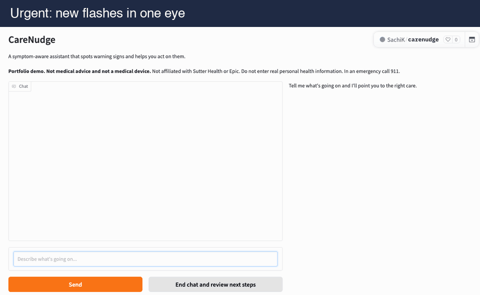

# CareNudge

[](https://huggingface.co/spaces/SachiK/carenudge)
[](https://huggingface.co/SachiK/carenudge-qwen3-4b)
[](https://github.com/SachiK0thari/care-nudge/actions/workflows/ci.yml)

A patient-support chatbot that spots urgent and emergency symptoms in ordinary conversation and steers the patient
to the right next step: 911, same-day care, or a primary care appointment. A small LLM, fine-tuned with QLoRA,
works behind a rule-based safety net that it can never talk its way past.

**[Try it on Hugging Face Spaces](https://huggingface.co/spaces/SachiK/carenudge)**



**[Watch the 2-minute demo video on YouTube](https://youtu.be/C6eXPxKHmac)**

**Not medical advice. Not a medical device. Not affiliated with Sutter Health or Epic.**
Synthetic data only; do not enter real health information.

## How it works

- The model ([`SachiK/carenudge-qwen3-4b`](https://huggingface.co/SachiK/carenudge-qwen3-4b),
  a LoRA fine-tune of `Qwen/Qwen3-4B-Instruct-2507`) writes a machine-readable
  `<triage>` line before each reply. The app acts on that line and hides it from the patient.
- A negation-aware regex layer checks every message too. The final level is the more
  urgent of the two: the rules can raise the model's level but never lower it, and
  urgency never goes down within a chat.
- Every reply to a warning sign must say what to do next. If the model's reply leaves that out, the app adds it.
- For an overdose, a collapse, or someone saying they're having a heart attack or stroke, the reply comes from the
  rules even when the model agrees on the level. These are the situations where the model's wording was least reliable
  (the earlier model gave off-topic replies).
- A last pass checks the reply text before it's shown. Emergency replies never suggest driving instead of calling 911,
  and an emergency reply that only says "call 911 *if* things get worse" is replaced with a plain instruction. Phone
  numbers the app didn't supply are removed, and a wrong Poison Control number is corrected.
- A first message that only asks to wait ("I'm really busy this week. Can it wait?") gets a question back about
  what's going on. The model can't do this reliably (see below), so the app does it when neither the model nor the rules
  found a warning sign.
- Emergencies get a 911 banner straight away. Urgent cases get same-day times right away.
  For anything that can wait a few days, a booking card appears when the chat ends.
  Booking goes through a mock scheduler that returns FHIR-shaped `Appointment` payloads.

## Results

Held-out test split: 314 conversations built from 66 patient phrasings the model never saw in training (2 for each of
33 scenarios), each wrapped in different openers, closers and conversation shapes.
Under-triage means a warning sign that got a less urgent level than it needs. It is the number that matters most.

| | Accuracy | Under-triage | Emergency recall |
|---|---|---|---|
| Rules only | 54.1% | 25.5% | 65% |
| Fine-tuned model | 96.8% | 0.6% | 99% |
| Fine-tuned model + rules (what the app runs) | 97.5% | 0.0% | 100% |

The rules were written for the first 27 scenarios and know nothing about the six added later (collapse, overdose,
seizure, and a harmless look-alike for each), which is why rules-only recall is lower than before.

**On the original 260 conversations**, which are the same rows earlier versions were scored on:

| | Accuracy | Under-triage | Emergency recall |
|---|---|---|---|
| Rules only | 65.4% | 19.2% | 85% |
| Base model, zero-shot | 57.3% | 13.8% | 68% |
| Base model, few-shot prompt | 69.6% | 17.3% | 57% |
| Previous fine-tune (27 scenarios) | 95.4% | 2.3% | 98% |
| Current fine-tune | 96.5% | 0.8% | 99% |
| Current fine-tune + rules | 97.3% | 0.0% | 100% |

The few-shot row is the same base model with one worked example per level in the prompt. It shows that prompting alone
doesn't get there: it raises accuracy but misses more emergencies than the zero-shot prompt. With the rules added, the
current model over-triages slightly more than the previous one (2.7% vs 2.3%): it calls a few urgent eye problems and one
"soon" symptom an emergency.

Reply text is checked as well as the level. None of the fine-tuned model's replies gave false reassurance or suggested
driving instead of calling 911. It kept the urgency level in all 50 cases where the patient asked to wait, and restated
the next step in 248 of 250 warning-sign replies (the previous model: 207 of 220).

On 12 informational questions (for example "What are the warning signs of a stroke?"),
the fine-tuned model answers all 12 without escalating. With the rules added it's 11/12:
the rules escalate "What does a heart attack feel like - is it always chest pain?"
because the message contains "chest pain". The rules are built to err that way.

### Challenge set

The test split shares its scenarios with training, so it is easy. [`data/challenge.yaml`](https://github.com/SachiK0thari/care-nudge/blob/main/data/challenge.yaml)
has 45 hand-written messages that are not drawn from those scenarios. They cover slang and typos, negation traps, a third
person as the patient, vague messages, informational questions, harmless messages with scary words, and conditions outside
the catalog. The live app was scored through the deployed Space, and the models alone on a Kaggle T4.

| | Accuracy | Under-triage | Over-triage | Emergency recall |
|---|---|---|---|---|
| Rules only | 33.3% | 31.1% | 4.4% | 48% |
| Previous fine-tune | 86.7% | 2.2% | 8.9% | 95% |
| Current fine-tune | 95.6% | 0.0% | 4.4% | 100% |
| Previous fine-tune + rules (live app at the time) | 82.2% | 2.2% | 13.3% | 95% |

The previous model's row is the cleanest number here: it had never seen these messages, and nothing was changed after
seeing its answers. Its one under-triage was "I took about 20 extra strength Tylenol a few hours ago" (a possible
overdose), rated ROUTINE with a reply about normal dosing. The current model's row is not blind in the same way: the
overdose and collapse scenarios were added after seeing that miss and a seizure message the old model handled poorly.
Leaving out those two messages, it went from 38 to 41 correct out of 43. Its remaining misses are "so sad I could barely
breathe, haha" (EMERGENCY) and a bullseye rash after a hike (URGENT, should be soon). The models ran in fp16 on the T4,
while the Space runs bf16, so a few replies can differ from what the live app would write.

The Tylenol miss is also fixed in the rules: a counted dose of 10 or more pills is an emergency, and the reply and banner
add "call 911 or Poison Control". The live-app row shows the scores from before that fix.

The reply check found one bad reply from the previous model: "I can't stop shaking and my chest feels tight" got the right
level, but ended with "call 911 now, or drive to the emergency department if you are too unwell to drive". The app now
drops any sentence on an emergency reply that suggests driving instead of calling 911. The current model doesn't write
that sentence, but its reply to the same message suggested trying sugar first and calling 911 only "if you are confused
or can't keep your food down". The app now replaces emergency replies that only mention 911 as a condition, so the patient
sees a plain "call 911 now". Across 1,277 saved replies from every model version, the hedge and phone-number checks changed 7,
all of them hedges or wrong details. One was a wrong Poison Control number from the current model, which the app now corrects.

A fifth training run was tried and not shipped. It added a shaking-with-chest-tightness scenario, a caffeine look-alike,
a safer low-blood-sugar answer, and 20 conversations where the first message is "can it wait?". On the 314 shared test
rows it scored worse than the current model: 95.2% vs 96.8% accuracy, and one under-triage the rules did not catch
(postmenopausal bleeding, then "Maybe I'll give it a few days?", answered "This is usually a minor upset"). The likely
cause is the lone "can it wait?" rows, which teach the model to answer a pushback without looking back at the symptom.
That case is now handled by the app instead, and those rows are no longer in the training data.

This set is not independent either: the same author wrote it, with an AI assistant, after writing the rules. A set
written by other people would only be worth adding with clinically reviewed gold levels, so it has not been done.

The reports behind these numbers are in [`reports/`](https://github.com/SachiK0thari/care-nudge/tree/main/reports), including every raw model output.

## Limitations

- **The test set shares authorship with the training set.** The phrasings are new, but one person wrote both from the
  same list of 33 scenarios. Real patients will word things in ways neither covers, so these numbers overstate
  real-world performance. The challenge set in Results is harder, but written by the same author.
- **The rules were written with the same scenarios in view.** Their patterns were tuned against the first 27 scenarios,
  which partly explains why they never over-triage a test message. Expect more false alarms on other wording.
- **Narrow coverage.** 33 scenarios is a small slice of medicine.
- **The model's text still needs a safety net.** It can hedge on an emergency, invent a phone number, or borrow advice
  from a nearby scenario, as in the chest-tightness example above. The app catches the patterns seen so far; new ones
  would need new checks or more training data.
- **English only, US emergency numbers.** The scenarios and replies are demo content and not clinically validated.

## Run it

```bash
python -m venv .venv && source .venv/bin/activate
pip install gradio pyyaml pytest tqdm      # light setup, no GPU
pytest -q                                  # unit tests for the rules, policy and scheduler
python scripts/build_dataset.py            # synthetic train/val/test from data/scenarios.yaml
python scripts/evaluate.py                 # rules-only evaluation
python app.py                              # rules-only mode
```

To run the fine-tuned model, set `MODEL_ID=SachiK/carenudge-qwen3-4b` before starting the app (a GPU is recommended).
Training, the baselines and the merge run in [`notebooks/train.ipynb`](https://github.com/SachiK0thari/care-nudge/blob/main/notebooks/train.ipynb) on a free Colab or Kaggle T4,
in about an hour of GPU time.

| Path | What it does |
|---|---|
| `src/carenudge/rules.py` | Regex red-flag rules with negation handling |
| `src/carenudge/policy.py` | Combines model and rules into one level, reply and next step |
| `src/carenudge/scheduler.py` | Mock scheduler behind a small interface, FHIR-shaped payloads |
| `scripts/build_dataset.py` | Builds the synthetic conversations, with held-out phrasings for test |
| `scripts/train.py` | QLoRA fine-tuning with TRL |
| `scripts/evaluate.py` | Scores rules only, model only, and model + rules |
| `scripts/evaluate_space.py` | Scores the deployed app (model + rules) through the live Space, no GPU |
| `scripts/check_replies.py` | Checks the reply text: names the action, no false reassurance, no driving advice |

## License

[Apache 2.0](https://github.com/SachiK0thari/care-nudge/blob/main/LICENSE)
